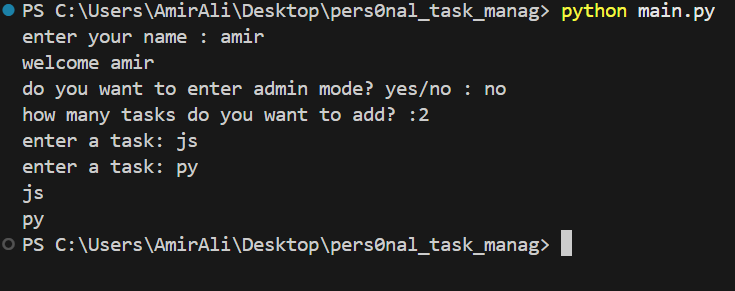
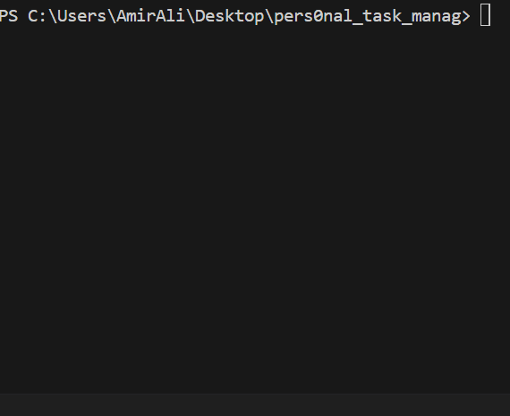

# Personal task Manager


A simple task manager built with python for learning git and github


## Features
- add multiple tasks
- save tasks
- load saved tasks
- admin mode
- set task priority

## Task priority

each task can have one of these priority levels:
- low
- medium
- high

## Requirements
- Python
- Python-dotenv

## Project structure
```
personal_task_manager/
│
│   .env.example
│   .gitignore
│   main.py
│   README.md
│   requirements.txt
│   tasks.py
│
├───gif/
│       Animation.gif
│
├───img/
│       img.png
│
└───
```

## Installation
Install the required packages:

```bash
python -m pip install -r requirments.txt
```

## Envoirment setup

create a `.env` file in the project folder

Use `.env.example` as a template

Add your admin password

```env
admin_pass=your_password_here
```

replace `your_password_here` with your own admin
password

## run the program 
run the main file 
```bash
python main.py
```

## screen shots



## demo


